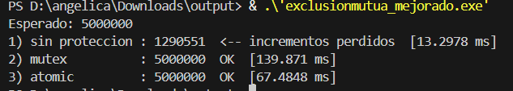
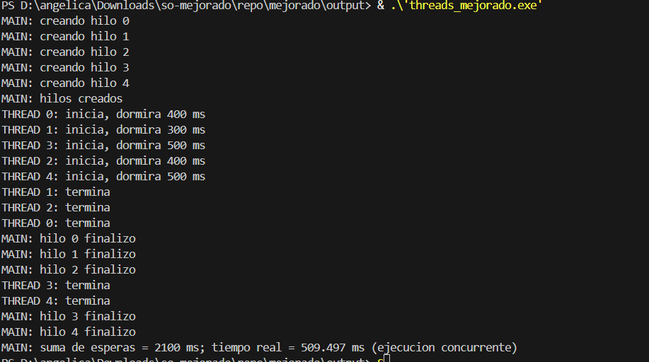
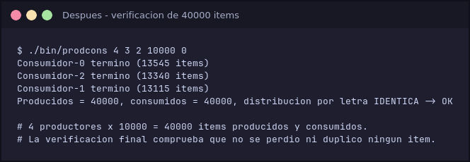

# Actividad 09 — Análisis y mejora de código concurrente

**Universidad La Salle · Facultad de Ingeniería**  
**Curso:** Sistemas Operativos  
**Docente:** Mg. Maribel Molina Barriga  
**Equipo:** angelica-hc, gmamanil-sudu, Diego Zapana, heydycastillo  
**Fecha:** 15 de noviembre de 2026

---

## Resumen

El repositorio reúne el análisis crítico, la ejecución y el mejoramiento de los
programas entregados para los cinco temas de la actividad: filósofos
comensales, monitores, exclusión mutua, threads y productor-consumidor.

En cada tema se conserva el código original y se añade una versión mejorada.
Las mejoras eliminan condiciones de carrera, interbloqueos, fugas de memoria y
bucles infinitos, y añaden verificaciones de resultados. Los programas mejorados
compilan con `-std=c++17 -Wall -Wextra -pthread` y fueron revisados con
ThreadSanitizer y AddressSanitizer/UBSan.

---

## Temas y mejoras

| Tema | Código original | Problema principal | Mejora aplicada |
|---|---|---|---|
| **Filósofos comensales** | `filosofos_comensales/originales/` | `Completo_1` no tiene tenedores; `Completo_2` libera los tenedores antes de comer, hace `unlock` doble y usa 5 tenedores fijos | `filosofos_comensales/filosofos.cpp`: N tenedores, `std::lock`, `fide` protegido, salida serializada y verificación final |
| **Monitores** | `Monitores/originales/` | Contador global sin sincronización, candado fuera del monitor y puntero sin inicializar | `Monitores/monitor00–04.cpp`: monitor encapsulado, `mutex`/`atomic`, hilos con `join` y sin fugas |
| **Exclusión mutua** | `Exclusion_Mutua/exclusionMutua00–02.cpp` | Condición de carrera al incrementar una variable compartida | `Exclusion_Mutua/exclusionmutua_MEJORADO.cpp`: comparación de sin protección, `mutex` y `atomic`, con tiempos y validación |
| **Threads** | `Threads/pthreads-example.cpp` | `rand()` compartido, `assert` que desaparece con `NDEBUG` y resultado del hilo descartado | `Threads/threads_MEJORADO.cpp`: `std::async`/`future`, RNG por hilo, `log()` protegido y manejo de errores |
| **Productor-consumidor** | `productor_consumidor/originales/` | Solo hay productores, sin búfer ni consumidor, y bucles infinitos | `productor_consumidor/mejorado/`: búfer acotado con `mutex`, dos variables de condición, cierre ordenado y verificación |

---

## Estructura del repositorio

```text
.
├── README.md
├── Informe                          # informe general en texto
├── Exclusion_Mutua/
│   ├── exclusionMutua00–02.cpp      # originales
│   ├── exclusionmutua_MEJORADO.cpp
│   └── exclusionmutua_mejorado.png
├── Threads/
│   ├── pthreads-example.cpp         # original
│   ├── threads_MEJORADO.cpp
│   └── threads_mejorado.png
├── Monitores/
│   ├── originales/monitor00–04.cpp  # originales entregados
│   └── monitor00–04.cpp             # versiones mejoradas
├── filosofos_comensales/
│   ├── originales/                  # Completo_1, Completo_2 y filosofos00–04
│   └── filosofos.cpp                # versión mejorada
└── productor_consumidor/
    ├── originales/productores00–02.cpp
    ├── mejorado/productor_consumidor_mejorado.cpp
    ├── capturas/
    ├── evidencias/
    ├── tools/
    ├── run.sh
    └── INFORME.md
```

---

## Cómo compilar y ejecutar

### Filósofos comensales

```bash
g++ -std=c++17 -O2 -Wall -Wextra -pthread \
    filosofos_comensales/filosofos.cpp -o filosofos

printf '20\n5\n' | ./filosofos
```

### Monitores

```bash
g++ -std=c++17 -O2 -Wall -Wextra -pthread Monitores/monitor04.cpp -o monitor
./monitor
```

Para compilar los originales:

```bash
g++ -std=c++17 -O2 -Wall -Wextra -pthread \
    Monitores/originales/monitor01.cpp -o monitor01_original
```

### Exclusión mutua

```bash
g++ -std=c++17 -O2 -Wall -Wextra -pthread \
    Exclusion_Mutua/exclusionmutua_MEJORADO.cpp -o exclusion

./exclusion 5 1000000 0
```

El último argumento `0` omite la variante insegura para que ThreadSanitizer no
reporte la carrera que se usa solo como demostración.

### Threads

```bash
g++ -std=c++17 -O2 -Wall -Wextra -pthread \
    Threads/threads_MEJORADO.cpp -o threads

./threads 5
```

### Productor-consumidor

```bash
cd productor_consumidor
./run.sh
```

El script compila los originales y el mejorado, ejecuta las pruebas y regenera
las evidencias en `productor_consumidor/evidencias/`.

---

## Resultados

| Tema | Verificación |
|---|---|
| Filósofos | Versión mejorada con 8 fideos y 3 filósofos: `8 + 0 = 8 (correcto)`; TSan sin avisos |
| Monitores | Los cinco programas imprimen 10, 20, …, 100; `monitor04` sin avisos de TSan |
| Exclusión mutua | 5 hilos × 200 000 iteraciones: `mutex` y `atomic` dan 1 000 000 exactos; TSan limpio con `demo_carrera=0` |
| Threads | 4 hilos con esperas de 1300 ms terminan en ~500 ms reales; TSan sin avisos |
| Productor-consumidor | 4 productores × 10 000 ítems = 40 000 producidos y 40 000 consumidos: `OK`; TSan limpio |

Los originales `exclusionMutua01.cpp` y `exclusionMutua02.cpp` conservan una
advertencia por la variable `arg2` sin usar. Las versiones mejoradas compilan sin
advertencias.

---

## Evidencias

- **Productor-consumidor:** `productor_consumidor/capturas/` contiene las seis
  capturas del antes y después, y `productor_consumidor/evidencias/` las salidas
  de compilación, ejecución y ThreadSanitizer.
- **Exclusión mutua:** `Exclusion_Mutua/exclusionmutua_mejorado.png`.
- **Threads:** `Threads/threads_mejorado.png`.







---

## Conclusiones

1. Una ejecución que “da el resultado esperado” no demuestra corrección: las
   carreras y los errores de sincronización pueden ocultarse.
2. `RAII` (`lock_guard`, `scoped_lock`, `future`) evita errores de liberación
   manual y fugas de recursos.
3. El encapsulamiento es parte de la sincronización: el candado debe vivir
   dentro del monitor.
4. Las operaciones de “comprobar y actuar” deben ser atómicas.
5. Para esperar una condición se usan variables de condición con predicado, no
   espera activa.
6. ThreadSanitizer, AddressSanitizer y las advertencias del compilador permiten
   detectar problemas que la salida por pantalla no muestra.

---

## Enlace del repositorio

**https://github.com/angelica-hc/SO_ACTIVIDA09**
