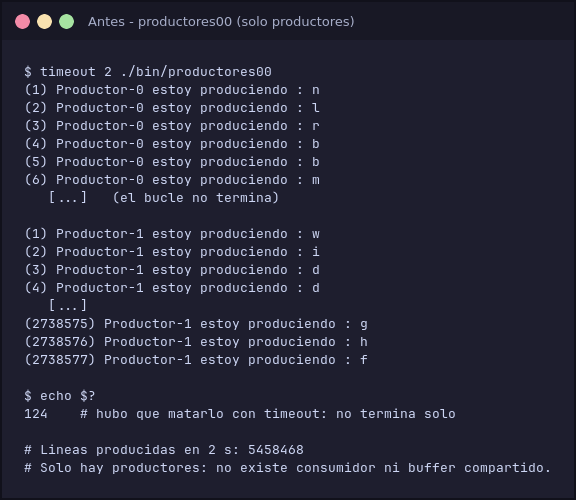
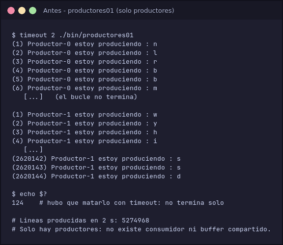
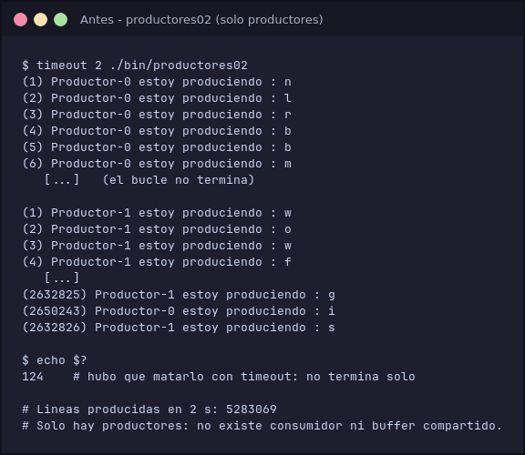
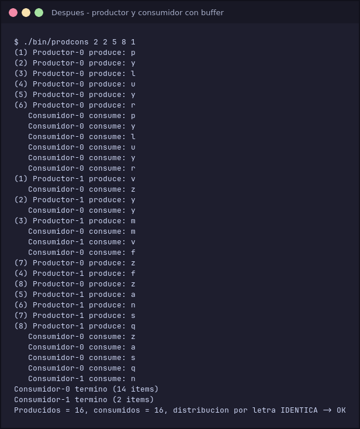
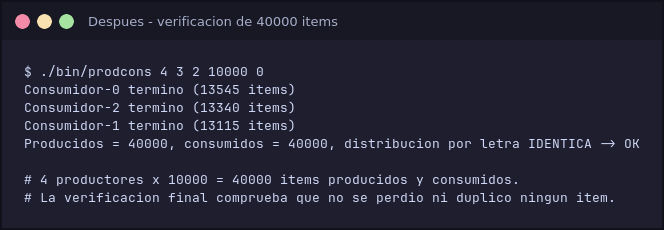
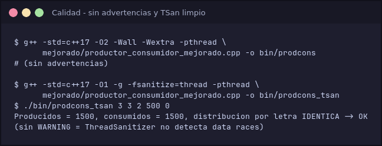

# Actividad 09 — Productor / consumidor con búfer compartido

**Asignatura:** Sistemas Operativos  
**Integrantes:** _(completar)_  
**Fecha:** _(completar)_  
**Tema:** análisis y mejora de la carpeta `productor_consumidor`

---

## 1. Objetivo

Revisar los tres programas originales de la carpeta `productor_consumidor`
(`productores00.cpp`, `productores01.cpp` y `productores02.cpp`), analizar su
funcionamiento, identificar sus problemas, implementar una solución correcta
de **productor y consumidor con búfer compartido**, ejecutarla, documentar los
resultados y presentar capturas del antes y del después.

---

## 2. Material revisado

| Archivo | Tecnología | Qué hace |
|---|---|---|
| `originales/productores00.cpp` | `pthread` (C) | Dos productores que generan letras e imprimen sin fin |
| `originales/productores01.cpp` | `std::thread` (C++) | La misma idea con hilos de C++ |
| `originales/productores02.cpp` | `std::thread` + clase | Encapsula el productor en una clase; mismo comportamiento |
| `mejorado/productor_consumidor_mejorado.cpp` | C++17 | Solución con búfer acotado, productores y consumidores |

Los originales se copiaron **sin modificaciones** desde el material entregado.

---

## 3. Metodología

| Aspecto | Detalle |
|---|---|
| Compilador | `g++` (GCC) con `-std=c++17 -Wall -Wextra -pthread` |
| Ejecución de los originales | `timeout 2`, porque son programas con bucle infinito |
| Detección de errores | Advertencias del compilador y **ThreadSanitizer** (`-fsanitize=thread`) |
| Reproducibilidad | `./run.sh` compila, ejecuta y regenera `evidencias/` |
| Criterio de corrección | El programa termina solo y verifica que lo producido sea igual a lo consumido |

Una ejecución “que parece funcionar” no demuestra corrección. Por eso la
versión mejorada incluye una **verificación de invariantes** al final.

---

## 4. Análisis de los programas originales

### 4.1 `productores00.cpp` (pthread)

- Crea dos hilos productores que generan una letra aleatoria y la imprimen.
- **No existe consumidor ni búfer compartido**: no hay nada que consumir ni que
  sincronizar. El programa no implementa el problema productor-consumidor.
- El bucle `for (int i = 1; true; i++)` es infinito: `pthread_join` nunca retorna
  y hay que matar el proceso.
- `rand()` se comparte entre hilos y POSIX no garantiza que sea seguro entre
  hilos. Además no se llama a `srand`, por lo que la secuencia es siempre la
  misma.
- `printf` desde dos hilos se entrelaza; en la evidencia se ven líneas cortadas
  o mezcladas.
- No se comprueba el valor de retorno de `pthread_create`.

### 4.2 `productores01.cpp` (std::thread)

- Repite el mismo diseño con `std::thread`.
- Presenta los mismos defectos: sin consumidor, sin búfer, bucle infinito,
  `rand()` compartido, salida sin sincronizar.
- El arreglo `identificadores` no se usa (advertencia `-Wunused-variable`).
- El `join()` de los hilos queda bloqueado para siempre.

### 4.3 `productores02.cpp` (clase Productor)

- Encapsula el productor en una clase, pero conserva el problema de fondo: solo
  produce e imprime.
- El hilo se lanza **dentro del constructor**. Si la clase creciera, el hilo
  podría empezar a ejecutarse antes de que el objeto terminara de construirse.
- Se usa `new` para cada productor y nunca se hace `delete`: fuga de memoria.
- `identificadores` tampoco se usa (advertencia del compilador).
- Mismos problemas de bucle infinito, `rand()` compartido y salida mezclada.

### 4.4 Problemas comunes

| # | Problema | Consecuencia |
|---|---|---|
| 1 | No hay consumidor | El programa no resuelve el problema pedido |
| 2 | No hay búfer compartido | No existe sincronización entre producción y consumo |
| 3 | Bucles infinitos | El programa nunca termina; `join()` no retorna |
| 4 | `rand()` compartido | Posible condición de carrera y secuencias repetidas |
| 5 | `printf` sin sincronizar | Líneas entrelazadas o cortadas |
| 6 | Sin validación de errores | Fallos de creación de hilos ignorados |

**Evidencia:** `evidencias/antes.txt` y las capturas 1, 2 y 3. En los tres casos
el código de salida es **124** (matado por `timeout`), lo que confirma que el
programa no termina por sí solo. En 2 segundos se generan más de 5 millones de
líneas sin que nadie las consuma.







---

## 5. Solución propuesta

La versión mejorada implementa un **búfer acotado compartido** como monitor:

```
BufferAcotado<T>
├── queue<T> q_                 // datos compartidos
├── size_t cap_                 // capacidad máxima
├── bool cerrado_               // fin de la producción
├── mutex m_                    // exclusión mutua
├── condition_variable no_lleno_ // el productor espera si el búfer está lleno
└── condition_variable no_vacio_ // el consumidor espera si está vacío
```

Operaciones principales:

- **`poner(x)`**: espera mientras el búfer esté lleno
  (`no_lleno_.wait(l, [&]{ return q_.size() < cap_; })`), inserta el dato y avisa
  al consumidor.
- **`sacar(x)`**: espera mientras no haya datos y el búfer no esté cerrado; si el
  búfer está vacío y cerrado, devuelve `false` y el consumidor termina.
- **`cerrar()`**: marca el fin de la producción y despierta a todos los
  consumidores para que vacíen el búfer y terminen.

Características adicionales:

- Número de productores, consumidores, capacidad e ítems configurables.
- Un generador `mt19937` por productor (sin `rand()` compartido).
- Salida serializada con un `mutex`.
- Conteo por letra en cada productor y cada consumidor.
- Verificación final: total producido = total consumido y distribución por letra
  idéntica. Si algo se pierde o se duplica, el programa termina con `FALLO`.

La espera con **predicado** evita los despertares espurios, y el uso de
`mutex` + variables de condición garantiza que no haya espera activa ni
condiciones de carrera sobre el búfer.

---

## 6. Ejecución y resultados

### 6.1 Ejecución didáctica

```bash
./bin/prodcons 2 2 5 8 1
```

Dos productores, dos consumidores, capacidad 5 y 8 ítems por productor. La salida
muestra la alternancia entre producción y consumo, y termina sola:

```
Producidos = 16, consumidos = 16, distribucion por letra IDENTICA -> OK
```



### 6.2 Prueba de esfuerzo

```bash
./bin/prodcons 4 3 2 10000 0
```

Cuatro productores, tres consumidores, capacidad 2 y 10 000 ítems por productor:
**40 000 ítems producidos y 40 000 consumidos**, sin pérdidas ni duplicados.

```
Producidos = 40000, consumidos = 40000, distribucion por letra IDENTICA -> OK
```



### 6.3 Calidad del código

- Compila sin advertencias con `-Wall -Wextra`.
- **ThreadSanitizer** no reporta data races:

```bash
./bin/prodcons_tsan 3 3 2 500 0
Producidos = 1500, consumidos = 1500, distribucion por letra IDENTICA -> OK
(sin WARNING = ThreadSanitizer no detecta data races)
```



Las evidencias completas están en:

- `evidencias/compilacion_originales.txt`
- `evidencias/antes.txt`
- `evidencias/despues.txt`
- `evidencias/tsan_mejorado.txt`

---

## 7. Comparación antes / después

| Aspecto | Originales | Versión mejorada |
|---|---|---|
| Consumidor | No existe | Sí, varios configurables |
| Búfer compartido | No existe | `BufferAcotado<T>` con capacidad |
| Sincronización | Ninguna | `mutex` + 2 variables de condición |
| Terminación | Infinita (`while(true)`) | Termina al cerrar el búfer |
| Generación aleatoria | `rand()` compartido | `mt19937` por productor |
| Salida | `printf` entrelazado | `cout` protegido por mutex |
| Verificación | Ninguna | Producido = consumido y conteo por letra |
| Memoria | `new` sin `delete` (02) | Sin reservas manuales |
| Data races | No se comprueban | TSan limpio |

---

## 8. Conclusiones

1. Los programas originales **no implementan** el problema productor-consumidor:
   solo producen e imprimen, sin búfer ni consumidor.
2. Un bucle infinito y la falta de un criterio de cierre impiden que el programa
   termine de forma ordenada.
3. El búfer acotado con `mutex` y variables de condición es la estructura
   adecuada: evita espera activa, protege los datos y permite cerrar limpiamente.
4. La verificación de conteos demuestra que no se pierden ni se duplican ítems.
5. ThreadSanitizer y las advertencias del compilador permiten comprobar lo que la
   salida por pantalla no muestra.

---

## 9. Cómo reproducir

```bash
cd productor_consumidor

./run.sh                     # compila y ejecuta; genera evidencias/
./tools/generar_capturas.sh  # regenera las capturas a partir de las salidas reales
```

Comandos individuales:

```bash
g++ -std=c++17 -O2 -Wall -Wextra -pthread \
    mejorado/productor_consumidor_mejorado.cpp -o bin/prodcons

bin/prodcons 2 2 5 8 1        # P C capacidad items verbose
```

---

## Anexo: estructura de la entrega

```
productor_consumidor/
├── originales/                 # los 3 programas entregados, sin modificar
├── mejorado/                   # solución con búfer compartido
├── capturas/                   # imágenes del antes y del después
├── evidencias/                 # salidas reales de compilación y ejecución
├── tools/                      # generación de capturas
├── run.sh                      # compila y ejecuta todo
└── INFORME.md                  # este documento
```
